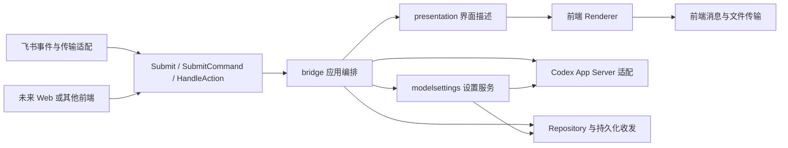

# 桥接分层与前端接入

整套桥接按“前端适配 → 应用编排 → 能力/存储端口”组织。会话路由、任务串行、审批授权、文件范围、持久化接收与恢复由应用统一负责；飞书 SDK、事件格式和卡片 JSON 留在适配层。当前运行入口仍是飞书，没有新增 Web 服务或监听端口。

| 层 | 位置 | 责任 |
|---|---|---|
| 运行装配 | `cmd/feishu-bridge` | 读取配置、选择适配器、连接服务、维护控制、生命周期与就绪回执 |
| 前端事件与传输 | `internal/feishu` | SDK 验签/事件解析、原生命令注册、消息/附件收发、将回调转换为应用动作 |
| 飞书界面 | `internal/feishuui` | 把语义 View 渲染成飞书卡片；固定格式探测样本。没有会话、任务、审批或持久化依赖 |
| 公共界面契约 | `internal/presentation` | View、Choice、Renderer、Action/Result；纯文本降级。不包含飞书字段、样式或 SDK |
| 应用编排 | `internal/bridge` | 账号验证、会话引用/默认/显式目标、单模型任务与队列、审批/回答期限与去重、文件权限、接收/发件恢复、空闲维护 |
| 模型设置服务 | `internal/modelsettings` | 全局/会话继承、能力校验、有效值与来源、下一轮快照、设置与快照互斥。依赖 Repository/Catalog 端口，不依赖前端或后端 JSON |
| Codex 适配 | `internal/codex` | stdio JSON-RPC、响应/事件分发；model/list 分页和字段转换。设置查询不启动新的客户端或模型任务 |
| 存储 | `internal/state` | 私有状态原子落盘、会话归属、引用路由、偏好持久化和进程独占锁 |
| 发布维护 | `scripts/` | 公共清单、延迟切换、空闲/锁保护及回退；不归任何前端控制 |

`bridge` 继续持有收发日志、队列和任务状态机，也继续编排 Codex 协议；这套编排对各前端共用。各前端复用现有状态机、持久化目录和兼容状态版本。

## 新前端的接入契约

1. 在独立适配包中完成鉴权和原生数据解析，映射为稳定的 `UserID`、`ChatID`、`MessageID`。不能接收客户端自报的可信账号、审批令牌归属或服务器路径权限。
2. 普通文字/附件调用 `Bridge.Submit(Input)`；按钮或 HTTP 命令可调用 `Bridge.SubmitCommand(Command)`，提供命令名称、参数和可选 ThreadID；交互选择/编辑/发送调用 `Bridge.HandleAction(presentation.Action)`。旧 `HandleCard` 是兼容别名。
3. 所有入口保留原请求 ID；重试不能生成新 ID。SubmitCommand 同样进入持久化接收队列，不直接调用模型。提交成功表示已接收，最终结果另行发送。
4. 实现 `Messenger.Send`；建议同时实现 `RoutedMessenger.SendRouted`，返回实际消息 ID，支持引用路由。需要富界面时实现 `RichMessenger` 与 `presentation.Renderer`，构造桥接时显式注入。无富界面可注入 `presentation.Text{}`。
5. 需要收发附件时实现 `FileTransport`；附件下载/上传都经过应用的大小、项目范围和归属检查。不能把文件协议当作绕过文件范围的新通道。
6. Renderer 只显示 View 并回传其中的不透明 token/choice ID。点击打开草稿、改选和手动发送仍是不同动作；前端不得点击即批准、生成任意审批 ID、延长期限或自动重放。
7. 在装配入口选择适配器，复用应用 Run、Recover 和维护流程。单个 Bridge 实例当前绑定一种前端格式和一个账号命名空间。跨前端共享身份、同时挂接多个前端以及 HTTP/WebSocket API 均尚未实现，不能直接混用同一私有状态目录。

发件记录增加格式标记；旧记录缺少标记时按旧飞书格式解释。渲染器格式变化后仅使用已保存的文字备用，不把另一前端的原生 JSON 当作当前界面发送。其余重试期限、消息去重和审批有效性检查继续生效。

## 模型与思考强度

可用值来自已连接 App Server 的 `model/list`，分页有界，目录错误或有效组合失效时不猜测模型、不启动任务。字段按官方 [App Server 文档](https://learn.chatgpt.com/docs/app-server) 转换。

| 操作 | 命令 |
|---|---|
| 列出当前账号可用模型及强度 | `/models` |
| 查看本桥接全局默认 | `/model global`、`/effort global` |
| 修改全局默认 | `/model global 模型ID`、`/effort global 强度` |
| 查看单会话有效值和来源 | `/model #编号`、`/effort #编号` |
| 修改单会话覆盖 | `/model #编号 模型ID`、`/effort #编号 强度` |
| 恢复继承 | 会话任一命令值写 `default`，模型和强度整套恢复继承；global 只清除对应字段 |

会话未自定义时：模型按桥接全局默认 → 桥接启动配置 model → 账号目录唯一默认选择；强度按桥接全局默认 → 所选模型默认选择。首次自定义任一项时，将模型与强度的有效值一起保存为独立配置；全局后续修改不影响它。未指定值时显示的是**下一轮有效设置**；若当前轮已开始，另外显示它已捕获的模型/强度，不把设置结果声称为当前轮已切换。

全局指本桥接应用/项目的保存默认，对该桥接已授权用户的会话生效；不会写机器的 Codex config.toml、其他项目或当前对话宿主模型。单会话值保存在桥接状态中，不因会话标题/摘要刷新丢失，重启后保留。普通新建和复制使用全局默认；/continue 按交接来源固定完整模型配置。

设置/查询只调用目录元数据；每轮开始显式向 `turn/start` 传 `model`、`effort`，防止已加载会话保留上轮覆盖。当前轮不被中断或修改；排队任务在实际启动时读取最新设置。全局变更不校验或覆盖完整独立会话。旧版单字段覆盖会先按变更前的全局配置补齐，两项与新全局默认一次原子提交；补齐失败则全局保持，要求修正旧会话或整套恢复继承。全局保存失败时快照和默认一同回退，重启后保留。

会话信息 `/show #编号` 和会话状态 `/status #编号` 复用同一设置服务，显示下一轮有效值与来源、当前轮已捕获值，并提供固定目标的设置草稿。当前轮等待启动确认时明确标注；目录查询失败不丢失基础会话/当前轮信息。外部只读会话不读取或推断原客户端设置。/status 只读本地保存值；/show 在释放任务互斥锁后查询目录元数据。

这里设置的是 reasoning effort，支持值由账号与模型决定；Default/Plan 协作模式、服务档位及其他产品中的模式不是这个参数，本次没有增加对应切换入口。

## 验证边界

架构测试拒绝应用生产文件引入飞书包/SDK或原生卡片标签。纯文本适配测试复用真实应用的新建、任务、手动审批；结构化前端命令测试复用同一接收队列和设置服务。原飞书 SDK 合成贯通、草稿、审批、路由和文件测试继续保留。

这些是本地合成验证，不是新的真实前端验收；模型账号能力、原生命令注册以及飞书客户端效果仍需候选上线后另行验证。

## 产品闭环入口

应用层提供projects、continue、files、result、cancelone，文本命令和结构化SubmitCommand共用同一授权/持久化入口。普通命令、控制命令各使用有界队列，后端事件独立处理；状态读取本地值，详情显式查元数据。派发后尚未完成的命令计入维护忙碌检查。模型推理仍由唯一active任务协调，未增加并行模型请求。

成果只通过绑定账号、聊天和会话的固定结果编号取回，不接受任意私有路径。发送队列快照送达后清理，独立私有成果快照保留用于重取；附件/成果列表最多20项，不扫描其他目录。/continue固定原项目和完整配置并检查交接文档；卡片预览不读网络、不创建会话，手动提交才执行。

## 会话话题与主聊天

可选 ConversationMessenger 端口为当前完整回复附上话题入口，并把记录同步到固定话题；没有该能力的前端保留原发送行为。飞书普通消息使用创建消息接口，话题记录使用 reply_in_thread 回复接口；从服务端回复获取真实 omt_ 话题标识，再用转发话题接口附原生记录卡片，普通正文不拼接链接。应用不构造飞书 JSON。

根消息按账号、聊天和 Codex 会话绑定并持久化，不能被其他会话、聊天或账号重绑。根路由独立保留，普通消息路由仍有容量与保留期限。主聊天送达回执先落盘，再同步话题并保存副本回执，最后发送原生话题记录卡片并保存回执；重试及重启复用各步骤回执。飞书适配器只缓存绑定同一聊天的服务端话题标识，重启时如需恢复则通过正常 API 校验已知根消息的消息、聊天及话题标识；不猜测 ID，不保存消息正文。主聊天输入的副本带来源标识且不再次提交模型，已在话题内的输入不重复复制。已知凭据格式在输入副本落盘前隐藏。

审批卡片保留在主聊天，话题仅记录说明文字；操作仍绑定原账号、聊天、任务和有效期，由用户手动提交。成果文件经过同一快照和范围检查后送达两个位置。既有散落消息不自动迁移，原生记录卡片与客户端展示需另行实测，不保证旧转发卡片自动刷新后续内容。
